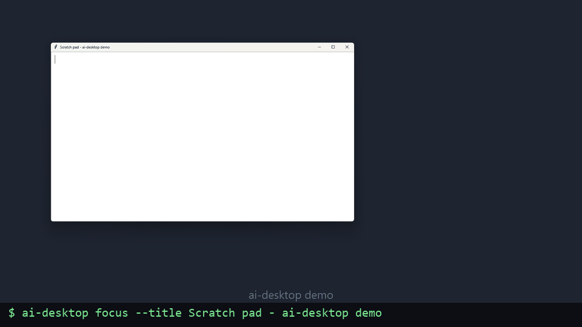

# AI Desktop Controller



[](https://github.com/MichaelDKulka/ai-desktop/actions/workflows/ci.yml)
[](LICENSE)

A small command-line tool (and MCP server) that lets **any AI agent that can run shell commands and look at images** see your desktop through a coordinate grid and control the mouse, keyboard, clipboard and windows. That includes driving your real, already signed-in Chrome. One Python file for the core, two dependencies, Windows / macOS / Linux (X11 and Wayland), multi-monitor, with an action log of everything the agent did.

> **⚠️ Safety warning.** Anything that can run this tool has **full control of your desktop and of every account that is logged in on it**: email, banking, admin consoles, password managers. Run it only with an agent you trust, watch what it does, and keep sensitive sessions closed while it runs.
>
> - **Windows, macOS, Linux X11:** a *failsafe* is on. Slam the mouse into **any corner of the primary screen** and the current and every following command aborts with exit code 3, until you move the mouse away.
> - **Linux Wayland:** there is no corner failsafe, because Wayland doesn't let apps read the pointer position. Stop the agent process itself (Ctrl+C in its terminal).

## Install

**One-shot setup** (creates `.venv`, installs, offers the Linux extras, then runs `doctor`):

```bash
git clone https://github.com/MichaelDKulka/ai-desktop
cd ai-desktop
./setup.sh                                               # macOS, Linux   (add --mcp for the MCP server)
powershell -ExecutionPolicy Bypass -File setup.ps1       # Windows        (add -Mcp for the MCP server)
```

**By hand:**

```bash
python -m venv .venv
source .venv/bin/activate          # Windows: .venv\Scripts\activate
pip install -e .                   # or: pip install -e ".[mcp]" for the MCP server (Python 3.10+)
ai-desktop doctor                  # tells you what your OS still needs
```

Or, without cloning: `pip install git+https://github.com/MichaelDKulka/ai-desktop` (and, once released, `pip install ai-desktop`).

Then finish the one-time steps for your platform under [Platform notes](#platform-notes). `ai-desktop doctor` lists exactly what is missing and how to fix it.

**Requirements:** Python 3.9+ (3.10+ for the MCP server). The only Python dependencies are `pyautogui` and `pillow`; pip pulls in what they need per OS (pyobjc on macOS, python-xlib on Linux). Linux Wayland additionally needs `gnome-screenshot` (or `grim`/`spectacle`), `xclip` and write access to `/dev/uinput`, see below.

## Commands

```text
ai-desktop screenshot [--grid] [--spacing 100] [--monitor all|primary|N] [-o screenshot.png]
ai-desktop grid --input image.png [-o gridded.png] [--spacing 100]
ai-desktop click --x 500 --y 300 [--button left|right|middle] [--double]
ai-desktop move --x 500 --y 300
ai-desktop drag --x1 200 --y1 150 --x2 900 --y2 400 [--duration 0.5] [--button left|right|middle]
ai-desktop type --text "hello world" [--interval 0.02]
ai-desktop key --key enter
ai-desktop hotkey --keys ctrl+c
ai-desktop scroll [--direction up|down] [--amount 3] [--x N --y N]
ai-desktop copy
ai-desktop paste [--text "any text, even é or ✓"]
ai-desktop clipboard get|set [--text "..."]
ai-desktop position
ai-desktop windows
ai-desktop focus --title "part of title" | --app NAME | --pid N | --id ID
ai-desktop monitors
ai-desktop launch-chrome [--url URL] [--profile "Profile 1"]
ai-desktop screenshots dir|latest|list [--limit 20]|clean [--days N | --all]
ai-desktop log [--limit 20]
ai-desktop doctor
ai-desktop mcp [--max-width 1920]
ai-desktop --version
```

Global flags, accepted before or after the command: `--json`, `--backend auto|pyautogui|uinput`.

**Output.** Every command prints one line an agent can parse, or an error on stderr:

```text
OK screenshot path=/home/me/.ai-desktop/screenshots/20261012-101905-123-grid100.png width=3286 height=1080 x=0 y=0 monitor=all spacing=100 scale=1.0 backend=pyautogui pruned=0
OK click x=520 y=340 button=left clicks=1
ERROR (5000, 50) is on no monitor; monitors: 0 eDP-1 at 0,0 size 1366x768
```

`windows`, `monitors`, `screenshots list` and `log` print one item per line after the first line. With `--json` (or `AI_DESKTOP_JSON=1`) each command prints one JSON object instead, errors included, and those lists become JSON arrays:

```json
{"ok": true, "command": "click", "x": 520, "y": 340, "button": "left", "clicks": 1}
{"ok": false, "command": "click", "error": "(5000, 50) is on no monitor; ...", "code": 1}
```

Exit codes: `0` ok, `1` error, `2` bad arguments (plain argparse text, never JSON), `3` failsafe abort.

**Screenshot coordinates are click coordinates.** The grid labels are global screen coordinates, so a point you read off the image is exactly what you pass to `click`, on any monitor. On HiDPI screens (a Retina Mac, or GNOME scaled to 200%) the capture is resized to the logical size first; `scale=` reports the original ratio.

**Key names.**
- Named keys: `enter`, `tab`, `esc`, `space`, `backspace`, `delete`, `up`/`down`/`left`/`right`, `home`, `end`, `pageup`, `pagedown`, `f1`–`f12`, `ctrl`, `shift`, `alt`, and `cmd` (also `win`, `super`, `meta`).
- Any single character also works, e.g. `hotkey --keys ctrl+a`.
- Aliases such as `return`, `escape`, `control`, `option` and `pgdn` are accepted.
- Unknown keys are an error, never silently ignored.

## Screenshots

`screenshot` saves to the tool's own folder, **`~/.ai-desktop/screenshots/`** on every OS (Windows: `C:\Users\you\.ai-desktop\screenshots\`), as `YYYYMMDD-HHMMSS-mmm[-mN][-gridSPACING].png` in local time. The path is printed each time, and `screenshots latest` finds the newest one again.

**Retention.** Files are deleted automatically when they are **older than 30 days**, and the oldest go first whenever the folder exceeds **2 GB**. The check runs inside the tool, at most once an hour, so there is no background service. Only files the tool named itself are ever removed; anything else you put in the folder, symlinks, and files written with `-o PATH` are never touched. The action log files (below) follow the same age rule.

```bash
ai-desktop screenshots dir            # where, how many, how big, current limits
ai-desktop screenshots latest         # newest file
ai-desktop screenshots list --limit 5 # newest first, one path per line
ai-desktop screenshots clean          # apply the rules now
ai-desktop screenshots clean --days 7 # or stricter
ai-desktop screenshots clean --all    # empty the store (and the logs)
```

Why not the system temp folder: macOS purges `/tmp` files unused for three days and Linux usually clears it on reboot, so 30-day retention would be meaningless there.

## Monitors

```bash
ai-desktop monitors
# OK monitors count=2 primary=0 virtual_x=-1920 virtual_y=0 virtual_width=3286 virtual_height=1080 source=xrandr
# 0 eDP-1 0,0 1366x768 primary scale=1
# 1 HDMI-1 -1920,0 1920x1080 scale=1
```

- Monitor `0` is always the primary; the others follow top-to-bottom, left-to-right. Coordinates are global: a monitor to the left of the primary has negative `x`.
- `screenshot` captures **all monitors in one image** by default (black where no monitor is). `--monitor 1` captures one monitor, `--monitor primary` the primary. Either way the grid labels are global, so clicks need no arithmetic.
- `click`, `move` and `scroll` accept any point on any monitor. `position` reports `monitor=` for the pointer.
- The layout comes from `xrandr` (Linux, also under Xwayland), `EnumDisplayMonitors` (Windows) or Quartz (macOS). If it can't be read, the tool assumes one screen and `doctor` warns.
- Known limit: Windows with *different* scaling per monitor isn't handled; keep the same scaling everywhere (100% recommended).

### Monitor-relative coordinates

`click`, `move`, `drag` and `scroll` take global coordinates by default. Add `--monitor N`
(an index from `monitors`, or `primary`) and x/y are relative to that monitor's top-left,
which matches the pixels of `screenshot --monitor N` without grid labels:

```bash
ai-desktop click --monitor 1 --x 100 --y 50        # 100,50 inside monitor 1
ai-desktop drag  --monitor 1 --x1 560 --y1 155 --x2 1100 --y2 420
```

A point outside that monitor is rejected. The MCP tools take the same optional `monitor`.

## Windows and focus

```bash
ai-desktop windows
# OK windows count=2 partial=False
# 0x3a00004 pid=4821 66,32 1300x736 active google-chrome "Inbox - Gmail - Google Chrome"
# 0x2200003 pid=3990 0,0 1366x741 minimized code "README.md - screen - Visual Studio Code"
ai-desktop focus --title gmail        # part of the title (or app name), case-insensitive
ai-desktop focus --app code           # part of the app / class / exe name
ai-desktop focus --pid 4821
ai-desktop focus --id 0x2200003       # exact id from the list above
```

Windows are listed front-to-back with their global geometry. When several windows match, an exact title match wins, otherwise the front-most one; `matches=` in the output says how many there were. `focus` restores a minimized window first and fails (exit 1) if the window did not come to the front.

- **Windows:** via the Win32 API; cloaked windows (UWP shells, other virtual desktops) and tool windows are skipped.
- **macOS:** via Quartz. Other apps' window titles are only visible with **Screen Recording** permission (without it, use `--app`). `focus` activates the app and raises the window with a System Events script, which asks once for **Automation** consent. Minimized windows and windows on other Spaces are not listed.
- **Linux X11:** via libX11 and the EWMH window-manager protocol, including under Xwayland.
- **Linux Wayland (GNOME):** only X11/XWayland apps are visible; GNOME has no public API to list or focus native Wayland windows. The output then carries `partial=True` and a note. Agents can still click a window, the dock, or the "is ready" notification. For full window control, log in to the "Ubuntu on Xorg" session.

## Action log

Every command appends one JSON line to **`~/.ai-desktop/logs/actions-YYYYMMDD.jsonl`** (one file per local day): timestamp, who ran it (`cli` or `mcp`), command, arguments, backend, result fields, exit code and duration. The `screenshot` entries carry the file path, so a session can be replayed from the log and the screenshots next to it.

```bash
ai-desktop log --limit 5
# OK log path=/home/me/.ai-desktop/logs count=5
# 13:05:09 cli click ok 412ms x=500 y=300 button=left clicks=1
# 13:05:01 cli screenshot ok 1188ms path=/home/me/.ai-desktop/screenshots/20261012-130501-022-grid100.png width=1366 ...
# 13:04:58 mcp type ERROR(1) 3ms cannot type these characters (ASCII only): 'é'
ai-desktop --json log                 # the raw entries
```

**Privacy.** By default the text given to `type`, `paste --text` and `clipboard set`, and the text returned by `copy` and `clipboard get`, is **not** stored: the entry keeps only the character count (`text_chars`, `chars`). Set `AI_DESKTOP_LOG_TEXT=1` to keep the full text. Set `AI_DESKTOP_LOG=0` to turn the log off. Log files older than `AI_DESKTOP_KEEP_DAYS` are deleted with the screenshots, and `screenshots clean --all` removes them too. Logging never fails or slows a command: if the file can't be written, the command still runs.

**Settings** (environment variables):

| Variable | Default | Meaning |
|---|---|---|
| `AI_DESKTOP_HOME` | `~/.ai-desktop` | Base folder; screenshots go in `screenshots/`, logs in `logs/` under it |
| `AI_DESKTOP_KEEP_DAYS` | `30` | Delete screenshots and log files older than this; `off` disables |
| `AI_DESKTOP_KEEP_MB` | `2048` | Keep the screenshot folder under this size; `off` disables |
| `AI_DESKTOP_LOG` | on | `0` turns the action log off |
| `AI_DESKTOP_LOG_TEXT` | off | `1` stores typed, pasted and copied text in the log |
| `AI_DESKTOP_JSON` | unset | `1` makes every command print JSON, same as `--json` |
| `AI_DESKTOP_BACKEND` | `auto` | `pyautogui` or `uinput`, same as `--backend` |
| `AI_DESKTOP_SCREEN_SIZE` | unset | `1920x1080` override for the Wayland backend |
| `AI_DESKTOP_UINPUT_DELAY` | `0.5` | Seconds to wait for the compositor to see a virtual device (Wayland) |

## Copy and paste

- **`copy`** presses the copy shortcut and prints what was copied. The shortcut is cmd+c on macOS and ctrl+c elsewhere. The first line is `OK copy chars=N`, and everything after it is the copied text (with `--json`, it is the `"text"` field). If nothing was selected it fails with an error, so an agent never mistakes old clipboard contents for a fresh copy.
- **`paste --text "…"`** puts the text on the clipboard, then presses the paste shortcut. Use it for anything `type` can't enter, like accented letters, emoji or long passages. Without `--text`, it pastes whatever is already on the clipboard.
- **`clipboard get`** and **`clipboard set --text "…"`** read or write the clipboard without pressing any keys.
- **Terminals** copy with ctrl+shift+c. There, run `hotkey --keys ctrl+shift+c`, then `clipboard get`.

Clipboard tools: macOS `pbcopy`/`pbpaste` and Windows PowerShell are built in; Linux needs `xclip` (or `xsel`, or `wl-clipboard`). On GNOME Wayland, `xclip` also works for native Wayland apps.

## Agent loop

```bash
# 1. See the screen
ai-desktop screenshot --grid
#    -> OK screenshot path=/home/me/.ai-desktop/screenshots/20261012-101905-123-grid100.png ...
#    -> the agent opens that image and reads coordinates off the grid

# 2. Act
ai-desktop focus --title "Chrome"
ai-desktop click --x 520 --y 340
ai-desktop type --text "search query"
ai-desktop key --key enter

# 3. Look again, and repeat until done
ai-desktop screenshot --grid
```

Tips for agents:
- Take a fresh screenshot after every action instead of assuming it worked.
- If a target sits between grid lines, re-run with `--spacing 50`, or zoom into one monitor with `--monitor N`.
- Use `windows` to find out what is open and `focus` before typing into a window.

## Connecting an AI agent

Any AI agent can drive this tool if it can do two things:

1. **Run shell commands** on the machine with the desktop (or connect to the [MCP server](#mcp-server)). That rules out chat-only assistants in a browser tab.
2. **Look at image files** (with MCP, the screenshot arrives inline). A text-only model can still type and press keys, but it is working blind.

Coding agents that run in your terminal or editor qualify: **Claude Code**, **OpenAI Codex CLI**, **Gemini CLI**, **xAI's Grok Build** (its file reader shows PNGs to the model), and similar tools.

### Setup

1. **Install the tool and run `ai-desktop doctor`** until it reports no failures.
2. **Give the agent the instructions in [`AGENTS.md`](AGENTS.md).** It explains the screenshot-then-act loop, the output format, and the safety rules (never type passwords, ask before posting or buying).
   - **Grok Build and Codex** read `AGENTS.md` automatically when started inside this folder.
   - **Claude Code** reads `CLAUDE.md`, which imports `AGENTS.md`.
   - **Gemini CLI** reads `GEMINI.md`: copy `AGENTS.md` to that name, or set `context.fileName` to `AGENTS.md`.
   - **Anything else:** paste the contents of `AGENTS.md` into its project instructions or system prompt.
   - Working from another folder? Point the agent at the file, or `cat AGENTS.md` into its prompt.
3. **Let the agent run the tool without a prompt for every command** (optional, and only if you will be watching the screen). Each agent has its own allow-list:
   - Claude Code: `/permissions`, or in `.claude/settings.json`:
     ```json
     { "permissions": { "allow": ["Bash(ai-desktop:*)", "Bash(.venv/bin/ai-desktop:*)", "Bash(python3 ai_desktop.py:*)"] } }
     ```
   - Grok Build: `grok --allow "Bash(ai-desktop:*)"`, or `--permission-mode auto` to approve everything; `--rules "$(cat AGENTS.md)"` appends the instructions to its system prompt.
   - Codex / Gemini CLI: see their approval-mode settings.

   With the rule in place nothing asks you before the agent clicks, types, or posts as you.

### Building your own agent

If you are writing an agent against a model API, the easiest route is the MCP server below. Without MCP:
- **Give the model one tool**, say `run(command)`, that runs an `ai-desktop` command and returns its output (use `--json` for easy parsing).
- **Return the picture after a screenshot.** When the command was `screenshot`, read the file from `path` and send it back in the tool result as an image, so the model actually sees it.
- **Use `AGENTS.md` as the system prompt.**

### Is this the right tool?

- **Web-only tasks.** Browser automation that reads the page's structure (Playwright, browser-use, Claude in Chrome) is usually faster and more reliable than clicking pixels, because the agent can target elements by text or role instead of coordinates.
- **Isolated testing.** A sandboxed setup, such as a VM or a Docker desktop like Anthropic's computer-use reference implementation, keeps the agent away from your real accounts.
- **What this tool is for.** Driving *your real desktop and signed-in apps* from *any* agent that has a shell or speaks MCP. No server to run, works on native Wayland, one Python file.

## MCP server

`ai-desktop mcp` runs the same commands as an [MCP](https://modelcontextprotocol.io) server over stdio. Every command is a tool with the same name (`screenshot`, `click`, `type`, `key`, `hotkey`, `scroll`, `copy`, `paste`, `clipboard_get`, `clipboard_set`, `position`, `windows`, `focus`, `monitors`, `launch_chrome`, `screenshots_latest`, `log`, `doctor`), and the **`screenshot` tool returns the PNG inline**, so the model sees it without opening a file. Errors come back as tool errors with the same messages as the CLI, and every call lands in the action log as `via=mcp`.

```bash
pip install -e ".[mcp]"          # needs Python 3.10+; the core stays on 3.9
ai-desktop mcp --max-width 1920  # what the clients below run for you
```

`--max-width` (default 1920) downsizes the inline copy of wide multi-monitor captures; the labels are enlarged first so they stay legible, and the file on disk stays full size. The JSON part of the result reports `inline_scale`. `0` disables the downscaling.

Client setup, using the absolute path of the installed command (clients do not inherit your virtualenv):

- **Claude Code:** `claude mcp add ai-desktop -- /abs/path/.venv/bin/ai-desktop mcp`
- **Claude Desktop:** in `claude_desktop_config.json`:
  ```json
  { "mcpServers": { "ai-desktop": { "command": "/abs/path/.venv/bin/ai-desktop", "args": ["mcp"] } } }
  ```
- **Grok Build:** `grok mcp add ai-desktop -- /abs/path/.venv/bin/ai-desktop mcp`
- **Codex:** `codex mcp add ai-desktop -- /abs/path/.venv/bin/ai-desktop mcp`
- **Gemini CLI:** `gemini mcp add ai-desktop /abs/path/.venv/bin/ai-desktop mcp`

Environment variables such as `AI_DESKTOP_HOME` or `AI_DESKTOP_LOG_TEXT` go in the client's `env` block for the server. The server's instructions carry the safety rules; `AGENTS.md` still makes a good system prompt.

## Using your signed-in Chrome

```bash
ai-desktop launch-chrome --url https://mail.google.com
ai-desktop screenshot --grid      # confirm you're signed in
```

`launch-chrome` opens your normal Chrome with your existing cookies, logins and extensions. If Chrome is already running, it opens a new window in that same session.
- **Windows:** finds `chrome.exe` under Program Files, `%LOCALAPPDATA%` or the registry, and points it at `%LOCALAPPDATA%\Google\Chrome\User Data`.
- **macOS:** runs `open -a "Google Chrome"`.
- **Linux:** launches through the desktop entry (`gtk-launch` or `gio launch`) when there is one, else the `google-chrome`/`chromium` binary on PATH.

Chrome opens the profile you used last. To pick a different one, pass `--profile` with the folder name, e.g. `"Profile 1"`. Folder names are listed under `chrome://version` → *Profile Path*.

On GNOME the new window opens **behind** the agent's own window and a "Google Chrome is ready" notification appears at the top of the screen instead; this happens with every launch method. Agents should take a screenshot after `launch-chrome` and click the notification or Chrome's dock icon (`focus` can't reach native Wayland windows, see above).

Remember that the agent now acts as **you** on every site you're logged into.

## Platform notes

Start with `ai-desktop doctor` on every platform. It prints one `ok` / `warn` / `fail` line per requirement, with the fix next to each failure, and exits 1 while anything fails. Run it from the same terminal or IDE the agent will use.

### macOS
Under **System Settings → Privacy & Security**, grant your terminal or IDE app (Terminal, iTerm, VS Code, …) both of these, then quit and reopen it:
- **Screen Recording.** Without it, screenshots show only the wallpaper and menu bar, with no windows, and `windows` can't see other apps' titles.
- **Accessibility.** Without it, clicks and keystrokes are silently ignored and `focus` can't raise windows.

The first `focus` also asks for **Automation** consent (controlling System Events). `doctor` reports the first two permissions (`screen-recording`, `accessibility`) for the app it was launched from.

Other notes:
- Use `cmd` in hotkeys (`hotkey --keys cmd+t`). `ctrl+c` on a Mac is Control-C, not copy.
- Scroll units are lines and feel small. Raise `--amount` if needed.

### Windows
- **Scaling.** 100% display scaling is recommended (`doctor` shows the current value). Other scales work as long as every monitor uses the same one.
- **Admin windows.** Input can't reach windows running as administrator (Task Manager, installers, UAC prompts) unless the tool itself runs from an elevated terminal.
- **Scroll.** `--amount` counts mouse-wheel notches.
- Nothing else to install: the clipboard uses PowerShell, which is built in.

### Linux on X11
In an X11 session, such as **"Ubuntu on Xorg"** picked from the gear icon on the login screen, input goes through pyautogui exactly as on Windows and macOS, failsafe included, and `windows`/`focus` see every window. Screenshots use `gnome-screenshot` (or `grim`/`spectacle`) when installed and Pillow's own X11 capture otherwise. Install `xclip` for the clipboard.

### Linux on Wayland
pyautogui can't see or control native Wayland windows, so on Wayland the tool switches automatically:
- **Screenshots** use `gnome-screenshot` (GNOME), `grim` (Sway, Hyprland) or `spectacle` (KDE).
- **Input** goes through the kernel's `/dev/uinput`, using short-lived virtual mouse and keyboard devices. This needs no extra Python packages.

One-time setup, tested on Ubuntu 24.04 / GNOME 46. `./setup.sh` offers to run these for you:

```bash
sudo apt install gnome-screenshot xclip

# Let the logged-in user create virtual input devices (same rule Steam uses)
echo 'KERNEL=="uinput", SUBSYSTEM=="misc", TAG+="uaccess", OPTIONS+="static_node=uinput"' \
  | sudo tee /etc/udev/rules.d/60-ai-desktop-uinput.rules
sudo udevadm control --reload-rules && sudo udevadm trigger
getfacl /dev/uinput     # should list user:<you>:rw-  (if not, log out and in, or reboot)
```

Wayland caveats:
- **Security.** Any program running as you can now inject keyboard and mouse input. Delete the rule file to undo it.
- **US layout only.** `type` assumes the **US keyboard layout** is active, since it sends physical key positions. With another layout, symbols will come out wrong. `paste --text` doesn't depend on the layout.
- **Speed.** Each action takes about 0.6 s, because the compositor needs a moment to notice each new virtual device. If clicks are dropped, raise `AI_DESKTOP_UINPUT_DELAY` (default `0.5` seconds).
- **No pointer position.** `position` reports `x=unknown y=unknown`.
- **Windows.** `windows` and `focus` only see X11/XWayland apps (see [Windows and focus](#windows-and-focus)).
- **Screen size and layout** come from Xwayland (`libX11`, `xrandr`). If that fails, set `AI_DESKTOP_SCREEN_SIZE=1920x1080`.
- **Snap-packaged terminals** (the VS Code snap, for example) inject their own library paths into child processes; the tool strips those before starting host programs, and `doctor` tells you when it has done so.

## Known limits
- No OCR or element finding: the agent reads coordinates off the grid.
- **Mixed DPI.** Monitors with different scaling factors (Windows) are not handled; HiDPI with the same factor everywhere is.
- **Wayland windows.** Native Wayland windows can't be listed or focused on GNOME; macOS doesn't list minimized windows or other Spaces.
- **ASCII only.** `type` handles printable ASCII, newline and tab, and rejects anything else (é, emoji, CJK) with an error. Use `paste --text` for those.
- **Scroll distance** per notch varies by app and platform.
- Windows and macOS are exercised by CI (install, unit tests, `monitors`, `windows`, `doctor`, live screenshots), but live mouse, keyboard and `focus` behaviour there depend on user reports.

## Development

```bash
pip install -e ".[dev,mcp]"
pytest                      # headless; never touches the real desktop
ai-desktop doctor
```

CI runs the tests and a CLI smoke test on Ubuntu, macOS and Windows with Python 3.9 and 3.12 (the MCP extra on 3.12 only), plus `monitors` and `windows` live on the macOS and Windows runners. The `doctor` and live-screenshot steps there are informational, because the runners have no desktop (Linux) or no permissions (macOS).

Rule for contributors: nothing may print to stdout except through `status()` / `fail()`, because under `ai-desktop mcp` stdout is the protocol channel. Every subprocess the tool starts captures or discards its output.

## Releasing

Pushing a tag like `v0.3.0` builds the package and publishes it to PyPI through [trusted publishing](https://docs.pypi.org/trusted-publishers/), so no API token is stored anywhere. One-time setup:

1. Create a PyPI account, then under *Your projects → Publishing* add a **pending publisher**: PyPI project `ai-desktop`, owner `MichaelDKulka`, repository `ai-desktop`, workflow `release.yml`, environment `pypi`.
2. In the GitHub repo, *Settings → Environments*, create an environment named `pypi` (already done).
3. Bump `version` in `pyproject.toml` and `__version__` in `ai_desktop.py`, update `CHANGELOG.md`, commit, then `git tag v0.3.0 && git push --tags`.

After the first release, `pip install ai-desktop` works everywhere.

## License

MIT, see [LICENSE](LICENSE).
